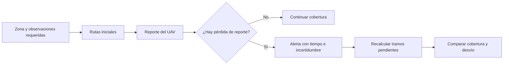

# Contexto compartido del proyecto de ruteo UAV — Tarea 2

**Actualizado:** 17 de octubre de 2026  
**Para:** integrantes del grupo 7  
**Propósito:** reunir lo hecho, los reparos recibidos, la investigación y la orientación del profesor en un solo documento. Las formulaciones nuevas son propuestas para discutir en el grupo; todavía no equivalen a una aprobación formal ni a un algoritmo implementado.

## 1. Resumen rápido

Partimos estudiando **CLUN-LSR**, un protocolo que recupera **rutas de comunicación entre drones** cuando el jamming afecta enlaces. En la Tarea 1 validamos fuentes geoespaciales y construimos parte de la infraestructura de datos, pero **aún no diseñamos ni evaluamos rutas resilientes**. El ayudante nos pidió centrar el proyecto en el algoritmo, demostrar el problema con evidencia y formular una hipótesis medible.

Tras conversar con el profesor, el enfoque que mejor encaja con el curso es usar una pérdida de comunicación como **alerta para modificar la trayectoria física de los siguientes UAV**. Para avanzar, tomamos como **propuesta a acordar entre todos** una misión de **reconocimiento de una zona delimitada**. Por tanto, el resultado principal ya no sería solamente un camino para paquetes, sino una ruta de vuelo que permita continuar la cobertura de la zona después de una pérdida de reporte.

## 2. Qué hicimos en la Tarea 1

El artículo base fue [Zheng et al., *Cross-layer UAV network routing protocol for spectrum denial environments*](https://doi.org/10.1016/j.adhoc.2024.103702). En ese artículo, cada dron es un nodo, los enlaces de radio forman las aristas y una ruta indica por qué UAV pasan los datos. La información sobre interferencia se comunica a la capa de red para actualizar vecinos y recalcular rutas. El artículo **sí considera movilidad** y usa simulación con propagación Two-Ray; no corresponde describirlo como un grafo estático o un escenario exclusivamente de espacio libre.

Nuestra propuesta agregó topografía, edificaciones, clima y capas geoespaciales de riesgo. Se desarrollaron scripts de consulta y evidencia para OpenSky, OpenTopography, OpenWeather, OSM/Overpass, OpenCellID, GPSJam, ACLED y OpenAIP. Se cargaron cuatro capas en PostgreSQL/PostGIS y se verificó una intersección espacial. Hay un informe LaTeX y el [PDF de la entrega](../03_TAREA_1/informes/Informe_Ruteo_APO_DPC_AML-1.pdf).

Esos resultados prueban principalmente que **podemos obtener, transformar y consultar datos**. No prueban todavía que CLUN-LSR haya mejorado una métrica en nuestro escenario, ni que exista una flota UAV real descrita por los datos. El [resumen técnico del proyecto](RESUMEN_PROYECTO_Y_TAREA_2.md) deja las cifras y archivos de evidencia exactos.

### Qué reutilizar y qué revisar

| Fuente o trabajo anterior | Valor para el proyecto nuevo | Límite |
|---|---|---|
| DEM de OpenTopography y consultas PostGIS | Relieve y operaciones espaciales reutilizables. | El recorte probado fue Santiago; si cambiamos de región, hay que obtener los datos de la zona elegida. La cota del terreno no es la altura de vuelo. |
| OSM/Overpass y OpenAIP | Posibles obstáculos y restricciones de vuelo. | Una huella 2D o un polígono sin altura no demuestra un bloqueo 3D. Verificar cobertura local y límites verticales. |
| Clima y OpenCellID | Posibles metadatos de contexto. | La densidad de antenas no mide congestión de la radio UAV; el clima puntual no demuestra por sí solo una pérdida de enlace. |
| GPSJam y ACLED | Antecedentes geolocalizados sobre degradación GNSS y eventos de conflicto. | **No son mediciones directas** del jamming sobre la comunicación de nuestros UAV ni entregan un radio de riesgo comprobado. |
| OpenSky | Demostró acceso a posiciones de aeronaves. | Entregó principalmente vuelos comerciales, no posiciones de la flota UAV; no debe usarse para cruzar aviones a gran altura con edificios de Santiago como si fueran drones bajos. |
| Scripts y BD actuales | Base para un ETL reproducible. | Falta el grafo físico de puntos y tramos, pgRouting, rutas, métrica, sitio y ejecución integral. Antes de compartir código, retirar las claves API incrustadas en scripts antiguos. |

## 3. Retroalimentación de la primera entrega

Los 14 reparos del ayudante pueden agruparse así:

1. **Problemática sin sustento suficiente.** Se afirmó que la interferencia ocurre o que la recuperación toma «mucho tiempo» sin cuantificar el fenómeno en un contexto concreto. Una cifra obtenida en la simulación del artículo no es un promedio universal de UAV. Hay que citar las fuentes y distinguir incidente, riesgo plausible y frecuencia medida.
2. **Hipótesis y objetivos mal centrados.** «Será posible estudiar» no predice un resultado falsable. El objetivo general debe ser **diseñar y validar el algoritmo de ruteo resiliente**; preparar bases de datos, consultar APIs o depurar scripts son tareas de apoyo. Los objetivos específicos deben abarcar todo el proyecto y nombrar la misión, el evento y la comparación propios del grupo.
3. **Modelo incompleto.** Si los drones se mueven, las aristas o las condiciones de vuelo cambian con el tiempo. Hay que representar ese cambio, usar coordenadas y alturas cuando se afirma trabajar en 3D y no mezclar elevación del terreno con altitud de aeronaves.
4. **Redacción y evidencia.** El informe tenía repeticiones y afirmaciones, figuras o tablas sin citas. En la siguiente entrega debe constar la fuente, fecha, zona, unidades y si un dato es observado o simulado.

Los comentarios numerados y el estado de cada corrección están en el [resumen completo](RESUMEN_PROYECTO_Y_TAREA_2.md).

## 4. Qué encontramos como contexto real

| Lugar | Qué sí respaldan las fuentes | Qué no respaldan |
|---|---|---|
| **Chile, cárceles** | [Gendarmería](https://html.gendarmeria.gob.cl/doc/cuenta_publica2018.pdf) documentó el ingreso de objetos ilícitos por drones y equipos antidrones; una [cuenta posterior](https://html.gendarmeria.gob.cl/doc/CuentaPublica_InformeE_2023_.pdf) registra neutralizadores y drones de vigilancia. | Aquí la autoridad inhibe drones intrusos. No hay un caso verificado de criminales interfiriendo una flota estatal de reconocimiento. |
| **México, crimen organizado** | [Intelligence Online](https://www.intelligenceonline.com/americas/2025/07/02/skyfend-discreet-chinese-provider-of-anti-drone-tech-to-mexican-cartels,110471806-art) reportó equipos SkyFend incautados en Durango y utilizados contra drones tácticos del Ejército; [Milenio](https://www.milenio.com/policia/mayiza-combate-fuerzas-armadas-equipo-anti-dron-elite) informó de inhibidores en manos de La Mayiza. Una [fuente oficial de Sinaloa](https://www.sspsinaloa.gob.mx/post/cargadores-municiones-equipo-t%C3%A1ctico-y-bater%C3%ADas-para-dron-fueron-asegurados-por-el-grupo-interinst) confirmó la incautación de una batería SkyFend. | El parte oficial confirma un componente, no el efecto medido de un ataque. No publica trayectorias ni recuperación de una red UAV. |
| **México/EE. UU., corredores terrestres** | [CBP describe drones que apoyan el seguimiento de traficantes en la frontera](https://www.cbp.gov/frontline/cbp-small-drones-program). [México informó un operativo fronterizo con drones](https://gabinetedeseguridad.gob.mx/contenido/9852/despliegan-500-efectivos-del-ejercito-y-guardia-nacional-con-el-apoyo-de-dos-helicopteros-de-la-fuerza-aerea-en-la-frontera-de-tamaulipas) contra tráfico de drogas y personas. | En ese operativo los equipos antidrones mencionados son de las autoridades. No documenta jamming criminal contra esos drones durante esa misma misión. |
| **Ucrania** | El [Ejército de EE. UU.](https://www.army.mil/article/284546/adapting_to_multi_domain_battlefield_developing_emissions_control_sop) y [CSIS](https://www.csis.org/analysis/lessons-ukraine-conflict-modern-warfare-age-autonomy-information-and-resilience) describen interferencia contra UAV usados en conflicto y reconocimiento. | Las fuentes revisadas no dan una misión completa de flota, enlaces y trayectorias recuperadas lista para replicar como evento histórico. |
| **Reino Unido** | Un [ensayo cooperativo de 20 UAV](https://www.gov.uk/government/news/swarming-drones-concept-flies-closer-to-reality) y sus [requisitos de red mesh](https://www.gov.uk/government/publications/competition-many-drones-make-light-work-phase-3/competition-document-many-drones-make-light-work-phase-3) justifican estudiar flotas bajo interferencia. | El informe público del ensayo no confirma que se aplicara jamming durante esa prueba. |

**Conclusión para citar en el trabajo:** existen antecedentes de interferencia y de vigilancia con UAV, pero no hemos hallado un **único caso público** con posiciones de una flota, jamming medido, cobertura de la zona y recuperación de rutas observadas. El caso real sirve para motivar; los eventos y parámetros no publicados deben presentarse como **escenario experimental simulado**. El [informe chileno sobre jamming](../03_TAREA_1/referencias/Tecnicas_de_Intercepcion_Telefonica.pdf) aporta antecedentes generales, sin acreditar por sí solo una misión como la nuestra.

## 5. Qué nos dijo el profesor y cómo lo entendimos

La [charla transcrita](../02_REUNION_PROFESOR/Charla_profesor.txt) contiene errores de reconocimiento de voz; estas son las ideas repetidas con suficiente claridad:

- **Aprovechar lo anterior y acotar la misión.** El profesor no exigió empezar desde cero.
- **Dar utilidad a la alerta.** Si un primer UAV deja de reportar y después pasa otro por una zona parecida, el segundo puede cambiar la trayectoria para continuar la misión. Si no hay otro UAV cuya decisión cambie, la información de la pérdida aporta poco al problema de ruteo.
- **Separar síntoma y causa.** Un beacon ausente indica que se perdió el reporte; la causa podría ser jamming, otra falla de comunicación o pérdida del UAV. La última posición conocida tampoco determina con exactitud la zona afectada.
- **Priorizar el cambio de ruta.** Para un mínimo viable se puede suponer que la alerta llega a quienes planifican; crear un protocolo completo de difusión podría quedar como trabajo futuro.
- **Escoger la misión.** Sugirió un contexto de conflicto, especialmente Ucrania, y explicó que reconocer una zona requiere medir **cobertura de un polígono**, mientras que llegar a un punto es otra formulación.
- **Drones físicos opcionales.** Los UAV comprados por la universidad no son un requisito evaluado del curso.

**Enfoque de trabajo para discutir en el grupo:** **reconocimiento de una zona**. La región concreta aún está pendiente. Ucrania fue la sugerencia del profesor; México también tiene antecedentes relevantes, pero con otro tipo y nivel de evidencia.

## 6. El cambio técnico central

| | Tarea 1: CLUN-LSR | Proyecto reformulado |
|---|---|---|
| **Vértices** | UAV individuales. | Puntos de paso y observación, con posición y altura. |
| **Aristas** | Enlaces de radio. | Tramos físicos de vuelo posibles. |
| **Ruta** | Camino de paquetes entre drones. | Trayectoria de uno o varios vuelos sobre el área. |
| **Disparador** | Detección de interferencia espectral que actualiza topología de comunicaciones. | Pérdida de reporte que genera una alerta temporal e incierta para replantear el vuelo. |
| **Éxito medido** | PDR, rendimiento de datos, recuperación del enlace. | Área reconocida y comunicada, tiempo de reacción y recorrido adicional. |

La conexión conceptual es **comunicación → alerta → decisión de vuelo**. CLUN-LSR puede inspirar la obtención y propagación temprana de la alerta, pero **no es por sí mismo un algoritmo de trayectorias**. Además, el ejemplo de beacon del profesor no es idéntico al sensado espectral y canal de gestión del artículo. Debemos nombrar exactamente qué mecanismo implementemos o simulemos.

Como artículo físico candidato encontramos [Luna et al. (2024), *A multi-UAV system for coverage path planning applications with in-flight re-planning capabilities*](https://doi.org/10.1002/rob.22342): planifica cobertura poligonal con varios UAV y replantea la misión tras perder uno; incluye simulación y vuelos reales. Sus autores [publicaron código](https://github.com/cvar-upm/coverage_path_planning). **No estudia jamming ni exactamente vuelos sucesivos con una zona incierta**. Todavía debemos decidir si lo adaptaremos, qué parte podremos implementar y cuál será el aporte específico del grupo.

## 7. Propuesta concreta para discutir entre nosotros

**Problema:** varios UAV reconocen un polígono. Uno deja de enviar reportes; solo contamos con su última posición y con las observaciones confirmadas hasta entonces. Los demás deben continuar la cobertura usando una trayectoria revisada. El resultado se compara con rutas que solo minimizan kilómetros.

**Modelo mínimo:** grafo `G(t) = (V,E(t))` de puntos 3D y tramos de vuelo. Cada arista tiene longitud en kilómetros y puede cambiar temporalmente de costo o disponibilidad tras una alerta. Para que la comparación sea justa, ambos métodos parten de la **misma zona, los mismos UAV, el mismo conjunto de puntos de observación y los mismos eventos de prueba**. En una primera versión el orden de esos puntos puede fijarse; optimizar el orden y repartirlos entre drones sería una ampliación.

**Hipótesis de trabajo, refutable:** bajo los mismos escenarios de pérdida simulada, incorporar alertas recientes al planificador logrará una **mayor fracción de área observada y reportada** que seleccionar tramos solo por distancia, sin exceder un límite de kilómetros adicionales decidido antes de la evaluación. Si la cobertura no mejora o el desvío supera ese límite, la hipótesis falla.

**Objetivo general propuesto:** diseñar y evaluar un algoritmo de ruteo físico resiliente para UAV que reconocen una zona delimitada, adaptando trayectorias después de una pérdida de reporte y comparándolo con rutas por distancia.

**Objetivos específicos propuestos:** (1) modelar la zona, la cobertura y el grafo espacial; (2) convertir una pérdida de reporte en una alerta con incertidumbre y duración definidas; (3) implementar rutas base y adaptativas para la misma misión; (4) comparar cobertura, reacción y costo del desvío bajo escenarios repetidos.

**Métricas mínimas:** cobertura confirmada = superficie observada **y reportada** dividida por la superficie de estudio; tiempo de detección y tiempo de cálculo por separado; kilómetros adicionales. Si no simulamos la transmisión de observaciones, debemos llamar a la primera métrica **cobertura geométrica**, sin atribuirle reporte. El período del beacon y el número de avisos perdidos son parámetros del experimento, no valores universales. Conviene incluir al menos una pérdida transitoria para medir reacciones innecesarias.

## 8. Cómo encaja con la Tarea 2

La tarea pide presentación en **Canvas** y proyecto en **GitLab UDP**. Debe poder ejecutarse en **Docker** y evidenciar todo el ETL y los resultados, no solamente mostrar un mapa.

| Lo exigido | Aplicación directa |
|---|---|
| PostgreSQL + PostGIS + pgRouting, diagrama y SQL. | Guardar zona, puntos, tramos, alturas, alertas, preferencias y rutas; recrear todo desde cero. |
| Infraestructura, metadatos y amenazas en JSON/GeoJSON con explicación y carga a BD. | Crear el grafo físico y documentar fuente, fecha, unidades y qué geometrías/eventos son simulados. Reutilizar APIs solo donde sean pertinentes a la zona elegida. |
| Fallas, pesos y restricciones con valores por defecto. | Explicar cómo una alerta temporal cambia tramos; definir cobertura objetivo, restricciones de vuelo y límite de desvío. |
| Artículo y algoritmo elegido. | Fundamentar la **planificación física** con un paper adecuado; CLUN-LSR queda como antecedente de comunicaciones. |
| Rutas base con `pgr_dijkstra`, costo solo en kilómetros. | Conectar puntos de observación por distancia. La función básica devuelve un camino mínimo; generar una segunda ruta distinta requiere un procedimiento explícito y reproducible. |
| `k ≥ 2` rutas con cada método, métrica y diferencial, según la rúbrica. | Evaluar rutas sobre los **mismos escenarios** y mostrar la diferencia de resiliencia/cobertura. |
| Sitio Leaflet y `main` automático. | Mostrar zona, alerta, rutas y métricas; automatizar descarga, transformación, importación, cálculo y sitio. |

**Ambigüedad no resuelta en la reunión:** el punto 8 del enunciado habla de **una** ruta Dijkstra de ejemplo y dice que incorporar amenazas/metadatos corresponde a fase 3. La **rúbrica de Tarea 2** exige **dos o más rutas por método**, algoritmo elegido y métrica de resiliencia. Para planificar, conviene cubrir la rúbrica completa y, si se consulta al profesor, preguntarle con el ejemplo concreto de nuestra misión de cobertura.

## 9. Estado de decisiones y próximos pasos

| Estado | Tema |
|---|---|
| **Enfoque de trabajo por acordar en grupo** | Misión de **reconocimiento de una zona**; rutas físicas como resultado principal; la comunicación entrega una alerta que puede gatillar replanificación. |
| **Propuesto** | Puntos de observación compartidos por ambas alternativas, alerta temporal cerca de la última posición conocida y Luna et al. (2024) como artículo físico candidato. |
| **Pendiente** | Región y polígono; cobertura real de las fuentes; mecanismo exacto de detección; número de UAV; parámetros de sensor y de tiempo; algoritmo y paper definitivos; alcance exacto de la rúbrica. |

**Orden sugerido:** fijar el caso en una página → elegir el artículo y la variante implementable → construir un escenario pequeño y reproducible → producir rutas comparables → calcular métricas → integrar BD, Docker, Leaflet y presentación. Antes de subir el repositorio, mover las claves API antiguas a variables de entorno.

### Archivos para profundizar

- [Transcripción de la conversación](../02_REUNION_PROFESOR/Charla_profesor.txt), con errores de reconocimiento de voz.
- [Interpretación detallada de la charla](ENFOQUE_TRAS_CHARLA_PROFESOR.md).
- [Resumen técnico completo y reparos numerados](RESUMEN_PROYECTO_Y_TAREA_2.md).
- [Contexto original de la Tarea 1](../03_TAREA_1/CONTEXTO_PROYECTO_CODEX.md), útil como antecedente histórico.
- [Informe presentado en la Tarea 1](../03_TAREA_1/informes/Informe_Ruteo_APO_DPC_AML-1.pdf).

**Idea para alinear al grupo:** conservar la experiencia adquirida con comunicaciones y datos geoespaciales, pero demostrar ahora **qué decisión de vuelo cambia, por qué cambia y si realmente mejora la cobertura** en una comparación verificable.
