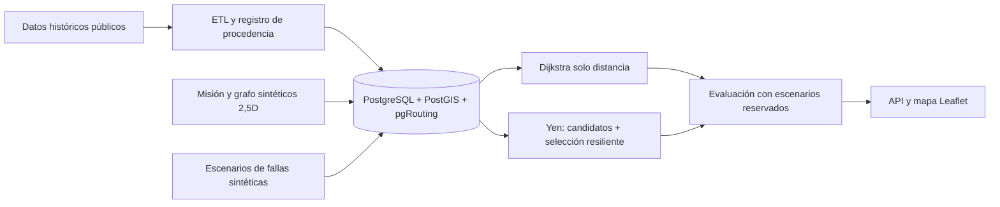

# Fase 0 — Auditoría y validación de factibilidad de Tarea 2

**Fecha:** 18 de octubre de 2026  
**Alcance:** lectura del repositorio, validaciones locales no destructivas y consultas públicas/acotadas. No se modificó código, SQL, Docker, datos existentes ni configuración Git. No se generaron trayectorias de vuelo.  
**Escenario provisional:** inspección territorial civil simulada, inspirada en cartografía e información histórica de Mykolaiv. El lugar, la ventana temporal y las fuentes definitivas siguen sujetos a factibilidad.

## 1. Dictamen

El enfoque de **un único grafo físico geolocalizado** es técnicamente factible como simulación. La Tarea 2 **no está implementada** en el repositorio actual. El código conservado de la Tarea 1 aporta extractores y carga PostGIS, pero está orientado a Santiago y a capas de una red de comunicaciones. La condición más frágil para avanzar es obtener **tres fuentes independientes de fallas/amenazas con datos pertinentes y un modelo de efecto defendible** para una misma zona y periodo. Las consultas de esta fase no permiten declarar cumplida esa condición.

El contexto civil sigue siendo plausible: el PNUD documenta un programa de recuperación en Mykolaiv y equipamiento de recopilación espacial/aérea para una comunidad de la región en 2026. Esos antecedentes no prueban fallas de rutas UAV ni justifican vuelos reales. [Programa regional](https://www.undp.org/ukraine/projects/mykolaiv-strategic-partnership), [equipamiento geoespacial](https://www.undp.org/ukraine/press-releases/undp-provides-equipment-five-ukrainian-communities-support-data-driven-recovery).

Se recomienda una misión mínima con origen, **dos o tres puntos obligatorios de observación** y destino, con orden de visita fijo. Cada tramo consecutivo permite la comparación origen–destino exigida por la rúbrica. La evaluación de la misión no equivale a cobertura continua del área.

### Convención de evidencia

- **C-R:** comprobado por lectura o validación local del repositorio.
- **C-E:** comprobado por una consulta externa realizada en esta fase.
- **D:** capacidad o limitación documentada por la fuente oficial; no equivale a validar datos en el área elegida.
- **I:** inferencia técnica que necesita prueba.
- **P:** decisión o diseño propuesto, todavía no implementado.
- **NV:** no validado para el caso de estudio.

## 2. Auditoría del repositorio

### Estado Git y documentación

**C-R:** La rama es `main`, rastrea `origin/main` y el único remoto configurado es `https://github.com/Aropoint/AlgoritmosRuteo.git`. El último commit observado es `8c6eef8` del 17-10-2026. Hay 49 archivos rastreados y dos archivos sin seguimiento en la raíz: `CONTEXTO_INTEGRAL_CODEX_RUTEO_UAV_2026_V3.md` y `PROPUESTA · EXTENSIÓN CLUN-LSR.pdf`. El enunciado de Tarea 2 exige trabajar en el proyecto del equipo de **GitLab UDP**; no hay remoto GitLab configurado y no se verificó la existencia ni el acceso al proyecto asignado. No se alteró ningún remoto.

**C-R:** El `README.md` raíz aún afirma que no hay remoto ni commit. Esa frase quedó obsoleta. El `.gitignore` excluye `.env`, `credentials.json`, datos crudos y el video; `git check-ignore` confirmó las dos primeras exclusiones. No se leyeron ni imprimieron valores de credenciales. Antes de compartir los dos archivos sin seguimiento habrá que decidir qué conservar y revisar su contenido/licencias. Existe un directorio `.git` vacío dentro de `validacion_ruteo`, pero `git -C` resuelve al repositorio raíz; no se trató como otro repositorio.

### Componentes existentes y reutilización

| Componente | Evidencia y estado actual | Reutilización o adaptación necesaria |
|---|---|---|
| `common.py` | **C-R:** variables de entorno, bbox, JSON/CSV y distancia Haversine. Sus valores por defecto apuntan a Santiago. | Reutilizar utilidades; parametrizar zona/fecha y unidades. Importarlo crea el directorio `evidencia`, por lo que los ensayos de lectura no importaron el módulo. |
| `02_opentopography.py` | **C-R:** descarga SRTMGL3 GeoTIFF y calcula estadísticas. | Conservar patrón ETL; separar raster original, atributos derivados y procedencia. Validar resolución y muestreo en la zona definitiva. |
| `04b_osm_buildings_fallback.py` | **C-R:** consulta Overpass y exporta solo `way` como Polygon; descarta `relation` y casi todas las etiquetas, incluidas `height` y `building:levels`. | Adaptación prioritaria: preservar etiquetas/identidad, manejar multipolígonos y validar geometrías. No tratar calles OSM como aristas aéreas. |
| `03_openweather.py` | **C-R:** clima actual en un punto; resumen sin fecha/hora observada. | Útil para comprobar acceso, pero no para un escenario histórico reproducible sin incorporar fecha y elegir un producto histórico. |
| `05_gpsjam.py` | **C-R:** CSV diario global a polígonos H3. | Reutilizable como lector si hay cobertura local; no mide comunicaciones UAV ni prueba causa de la baja precisión GNSS. |
| `06_acled.py` | **C-R:** OAuth, consulta por país/fecha y GeoJSON de puntos. No conserva `geo_precision` ni `time_precision` en el GeoJSON. Puede cambiar automáticamente a otra fecha si no hay datos. | Preservar precisión y registrar fecha efectiva; eliminar el cambio silencioso de periodo para la evaluación. No convertir puntos en cierres de arista. |
| `07_openaip.py` | **C-R:** descarga zonas y exporta tipo/geom; omite límites verticales/temporales del registro. | Adaptar solo si existe cobertura útil. Para 2,5D una intersección horizontal no basta para declarar restricción. |
| `01_opensky.py`, `04_opencellid.py` | **C-R:** posición de aeronaves y celdas celulares. | Conservar como legado de Tarea 1; no son la infraestructura de navegación física propuesta. |
| `03_TAREA_1/pruebas_iniciales/` | **C-R:** cuatro prototipos cortos para peticiones, terreno y ruido; se revisaron imports/estructura sin ejecutarlos. | Referencia histórica; el paquete `validacion_ruteo` ya concentra la funcionalidad reutilizable. |
| Colección Postman | **C-R:** colección de peticiones de fuentes de Tarea 1. | Referencia para documentación de endpoints; no sustituye ETL reproducible ni pruebas de cobertura Mykolaiv. |
| `sql/init_postgis.sql` | **C-R:** extensión PostGIS; tablas e índices GiST para cuatro capas históricas. | Aprovechar patrón de almacenamiento. Faltan pgRouting, vértices/aristas, misión, escenarios, costos, rutas y procedencia temporal. |
| `docker-compose.yml` | **C-R:** imagen `postgis/postgis:16-3.4`; `docker compose config --quiet` terminó correctamente. | El archivo no instala ni habilita pgRouting. La ejecución del contenedor/BD no se verificó en esta fase. |
| `import_geojson_to_postgis.py` | **C-R:** carga GeoJSON de cuatro capas existentes con UPSERT y reparación poligonal. | Aprovechar estructura de carga, con nuevos esquemas y validaciones. No carga DEM, clima, FIRMS, red física ni escenarios. |
| `postgis_evidence.py` | **C-R:** evidencia de tablas, tipos e intersección con una línea de prueba creada para Tarea 1. | Reutilizar estilo de evidencia espacial. Esa línea no es una ruta calculada ni muestra pgRouting. |
| `run_all.py` | **C-R:** ejecuta ocho extractores antiguos y sobrescribe `resumen_validacion.json`; no inicia DB, no carga todas las fuentes ni habilita sitio. | No ejecutarlo tal como está para Tarea 2. Evolucionarlo posteriormente a un flujo reproducible, sin duplicar los extractores. |
| Sitio y algoritmo | **C-R:** no aparecen aplicación Leaflet, tablas de grafo, `CREATE EXTENSION pgrouting`, `pgr_dijkstra`, Yen ni métrica de misión en los componentes revisados. | Nuevos módulos necesarios después de aprobar diseño y fuentes. |

**Validaciones no destructivas:** los 12 archivos `.py` del paquete pasaron análisis sintáctico con `ast.parse`; eso **no prueba** ejecución funcional. Compose pasó validación de configuración. La consulta al daemon Docker devolvió `permission denied` desde el entorno actual, por lo que no se atribuye una prueba nueva de PostgreSQL o pgRouting. Los conteos de PostGIS guardados son evidencia histórica de Tarea 1.

### Valor y límites de la evidencia heredada

**C-R:** `evidencia/resumen_validacion.json` registra un DEM de 360×360 celdas y 236.791 polígonos OSM del bbox de **Santiago**. `postgis/00_summary.json` conserva cuatro tablas de Tarea 1. Estos resultados prueban un ensayo anterior de extracción e intersección espacial, no cobertura actual de Mykolaiv ni viabilidad de una red física UAV. El informe heredado dice que ya había tres amenazas válidas; esa conclusión dependía de otro problema y otra geografía, por lo que no se traslada a Tarea 2.

## 3. Matriz de factibilidad: infraestructura y metadata

Se hicieron consultas mínimas para medir **acceso y atributos**, sin extraer una zona operacional ni construir rutas. Una muestra pequeña no representa toda Mykolaiv.

| Fuente | Resultado de Fase 0 | Uso defendible | Estado / límite |
|---|---|---|---|
| OSM, API principal | **C-E:** consulta de una muestra urbana de 0,01° × 0,01° cercana al centro: 348 `way` con `building`, solo 7 con `height` y 49 con `building:levels`. Se recibieron 2,4 MB XML. | Huellas como contexto y preferencias sintéticas de separación; alturas etiquetadas cuando existan. | **Parcial.** Las alturas explícitas son escasas en esta muestra; faltan relaciones/multipolígonos y validación en AOI final. La consulta Overpass equivalente devolvió HTTP 406; una instancia alternativa no fue alcanzable. No se validó el extractor Overpass actual allí. |
| OpenTopography | **C-E:** API Global DEM/SRTMGL3 respondió HTTP 200 para una muestra de 0,01° × 0,01°; GeoTIFF de 12×12 celdas, elevación observada de −7 a 26 m. No se guardó archivo. | Elevación del terreno y atributo 2,5D general. | **Parcial.** Cobertura de esa muestra sí; precisión de edificios/obstáculos y AOI definitiva no. [Documentación](https://www.opentopography.org/developers). |
| Open-Meteo histórico | **C-E:** consulta para un punto de referencia y un día de 2025 devolvió 24 horas de viento en km/h. | Condición ambiental fechada de misión; escenario de viento con umbral **supuesto**. | **Parcial.** Su reanálisis puede tener resolución de 9–25 km; no debe producir riesgo distinto para cada cuadra de un área menor. [Documentación](https://open-meteo.com/en/docs/historical-weather-api). |
| OpenWeather actual | **C-E:** endpoint actual respondió HTTP 200 con viento (velocidad, dirección, ráfaga), visibilidad y marca temporal. | Comprobar acceso y variables de situación actual. | **Parcial.** No se alinea con eventos históricos si se usa el script actual. No aporta por sí solo restricciones espaciales diferenciadas. [API](https://openweathermap.org/api). |

**Límite temporal:** OSM y OpenWeather se consultaron en el estado actual, mientras Open-Meteo y ACLED se probaron con fechas de 2025. Estas respuestas **no forman todavía un escenario espaciotemporal común**; habrá que fijar qué capas se tratan como cartografía de referencia y cuáles como observaciones fechadas.

**I:** Una red 2,5D pequeña puede generarse a partir de puntos de navegación **sintéticos**, DEM y restricciones explícitas. Los nodos serían posiciones posibles, no UAV; las aristas, desplazamientos candidatos, no enlaces RF. La disponibilidad de una segunda ruta entre cada par elegido, la proporción de alturas confiables y las restricciones que efectivamente cambien rutas deben probarse en la AOI definitiva. No se generó todavía el grafo.

**P:** Guardar `x,y,z_supuesto` y procedencia por nodo; `source,target,geom,longitud_km,estado,costo_modelado` por arista. El costo Dijkstra será **solo longitud en kilómetros**. Las capas externas y los estados de escenario se relacionarán con las aristas mediante reglas versionadas. La elevación del DEM no es altura de edificios; un cruce horizontal con una huella tampoco prueba colisión. El modelo se describirá como **2,5D**, no como navegación 3D validada.

## 4. Matriz de factibilidad: amenazas y fuentes candidatas

| Fuente | Acceso y registros comprobados | Utilidad para la misión | Dictamen |
|---|---|---|---|
| ACLED | **C-E:** OAuth y API respondieron 200 para el 04-09-2025: 235 eventos en Ucrania; solo **2** con `admin1=Mykolaiv`, ubicados en Kutsurub y Ochakiv, ambos con `geo_precision=2`. Ninguno valida por sí mismo el sector urbano elegido. | Antecedente histórico regional; no mide enlace UAV, obstáculo ni tramo cerrado. [Codebook](https://acleddata.com/methodology/acled-codebook). | **Acceso validado; utilidad local para pesos de arista NV.** No contarlo aún como falla física demostrada. |
| GPSJam | **C-R:** archivo histórico global de 03-09-2026 disponible. La celda H3 resolución 4 que contiene el punto de muestra de Mykolaiv **no aparece** en ese archivo. | Indicador agregado de precisión de navegación en aviones ADS-B; no prueba jamming ni sirve para comunicaciones UAV. [FAQ](https://gpsjam.org/faq). | **No validado como fuente local**; su ausencia puede reflejar falta de vuelos/receptores. |
| OpenAIP | **C-E:** API respondió 200, pero devolvió **0 elementos** tanto con `country=UA` como en una bbox de muestra urbana. | Si existiera información aplicable, sería una restricción espacial/vertical, no una falla observada. | **No validado para Mykolaiv.** No contarlo entre las tres fallas. |
| NASA FIRMS | **D:** la API por área ofrece anomalías térmicas y consultas históricas, pero exige `MAP_KEY`; no había una clave FIRMS configurada y no se hizo extracción local. Una detección no significa que todo el píxel esté afectado ni que una ruta se cierre. [API](https://firms.modaps.eosdis.nasa.gov/api/area/), [limitaciones](https://firms.modaps.eosdis.nasa.gov/map/). | Fuente ambiental potencial para escenarios de perturbación **modelada**, si hay observaciones en AOI/fecha. | **NV:** faltan acceso, registros, cobertura y regla de efecto. |
| UNOSAT Mykolaiv | **D:** evaluación de julio de 2022 publicada en octubre de 2022 con 198 estructuras de daño visible y descarga SHP/GDB anunciada. [Producto](https://unosat.org/products/3404). | Antecedente preciso e histórico de infraestructura civil dañada; podría respaldar la elección de puntos de inspección. No indica que un corredor aéreo esté bloqueado hoy. | **Candidato contextual**, no validado como tercera falla actual. |
| Copernicus EMS | **D:** ofrece productos geoespaciales por activación, como extensión de inundación o incendio. [Documentación](https://documentation.v1.dataspace.copernicus.eu/Data/CopernicusServices/CEMS.html). | Alternativa si se localiza una activación que coincida con zona y periodo y tenga geometrías útiles. | **NV** para AOI/fecha. |

**Resultado de control:** no se validaron **tres fuentes independientes de fallas útiles** para una misma zona y periodo. Tres nombres de proveedores, tres HTTP 200 o tres capas visuales no satisfacen por sí solos la justificación causal de pesos y restricciones. Para cualquier fuente observada se debe separar `dato original → incertidumbre → regla de simulación → aristas afectadas`; el cierre de aristas será un **supuesto de escenario**, no una afirmación sobre vuelos reales.

## 5. Arquitectura mínima propuesta

**P:** La BD necesita, como mínimo, tablas/versiones para fuente y extracción, capas externas, nodos y aristas físicas, misión y puntos obligatorios, reglas/preferencias, escenarios de falla, rutas y resultados. Todo método consultará **el mismo grafo base**; (G_t) será la instantánea tras aplicar un escenario, sin convertir las posiciones de los UAV en vértices. La posición del vehículo y los puntos visitados pertenecen al **estado de misión**. Esto deja espacio para un evento de pérdida de reporte como alerta incierta, sin afirmar una causa RF.

La secuencia de dos o tres puntos de observación mantiene un subproblema A→B por tramo. Para el MVP, el orden se fija de antemano; no se atribuye al proyecto optimización global de cobertura continua o asignación multi-UAV. No se generarán rutas operativas reales.

## 6. Comparación preliminar de algoritmos y evaluación

| Método | Papel | Procedencia y límite |
|---|---|---|
| `pgr_dijkstra` con `cost=longitud_km` | Referencia obligatoria. La primera ruta es la mínima; para la segunda se repetirán llamadas con una regla determinista de exclusión/desviación fijada antes de evaluar, siempre con costo de distancia. | La rúbrica exige la función específica. Dos consultas idénticas no producen dos rutas distintas. [pgRouting](https://docs.pgrouting.org/latest/en/). |
| Yen / `pgr_KSP` | Generar más de dos rutas candidatas simples por tramo. | Yen (1971) es el algoritmo publicado; `pgr_KSP` lo implementa usando Dijkstra. **No garantiza resiliencia ni disyunción**. [Paper](https://doi.org/10.1287/mnsc.17.11.712), [pgRouting](https://docs.pgrouting.org/latest/en/). |
| Selección y replanificación acotada | Elegir dos candidatas con presupuesto de recorrido y menor exposición/solapamiento según fallas **modeladas**; ante una arista revelada como indisponible, recalcular desde la posición simulada actual hacia el siguiente punto pendiente. | **Contribución propuesta del grupo**, todavía sin diseño formal ni validación. No atribuirla automáticamente a Yen ni a pgRouting. |
| Luna et al. (2024) | Referente para inspección de múltiples puntos y replanificación de tareas pendientes tras eventos inesperados. | El paper trata un sistema multi-UAV de cobertura; la adaptación mínima aquí **no reproduce su arquitectura completa**. [Artículo](https://doi.org/10.1002/rob.22342). |

**Métrica primaria propuesta:** proporción de escenarios reservados en los que se visitan todos los puntos obligatorios **y** se alcanza el destino dentro de un presupuesto de recorrido predefinido. Si no se modela un canal de reporte, medir **visita**, no «observación reportada» ni PDR.  
**Complementarias:** disponibilidad del par de rutas preseleccionadas, distancia total y sobrelongitud, porcentaje de puntos visitados cuando la misión falla, cantidad de replanificaciones, tiempo de cálculo y fallas de restricciones. La disponibilidad del par mide redundancia previa; no equivale a recuperación durante vuelo.

**Control experimental propuesto:** mismo grafo, misión, pares A→B, dos rutas finales, restricciones, presupuesto y escenarios para ambos métodos. Fijar semillas y versiones. Ajustar pesos y umbrales solo con un conjunto de calibración; reservar semillas, regiones de perturbación o ventanas distintas para la evaluación final. Reportar también un control Yen por distancia pura para distinguir generación de candidatos de selección por riesgo. La hipótesis de mejora puede resultar falsa.

## 7. Matriz de trazabilidad de la rúbrica (60 puntos)

**Existe** significa que hay una pieza reutilizable, no que el criterio esté cumplido para Tarea 2.

| Criterio | Pts | Existe | Falta / validación necesaria |
|---|---:|---|---|
| Docker PostgreSQL, PostGIS, pgRouting | 2 | Compose PostGIS; sintaxis válida. | Instalar/habilitar pgRouting y ejecutar contenedor; daemon no probado. |
| Explicar BD y entregar SQL desde cero | 2 | SQL de cuatro capas T1. | Modelo completo de grafo, misión, escenarios y resultados; diagrama. |
| Extraer `n` metadata a JSON | 6 | Extractores OSM, DEM y clima actuales. | AOI/periodo común, atributos preservados, JSON/documentación por fuente, evidencia reproducible. |
| Cargar `n` metadata a BD | 2 | Importador OSM GeoJSON. | Cargadores DEM/derivados y clima; verificar conteos y procedencia. |
| Extraer `n` fallas a JSON | 6 | Extractores ACLED, GPSJam, OpenAIP de T1. | Validar tres fuentes independientes pertinentes; FIRMS/alternativas pendientes. |
| Cargar `n` fallas a BD | 2 | Importador ACLED/GPSJam/OpenAIP de T1. | Cargadores para fuentes definitivas, fechas y precisión. |
| Explicar modelos de `n` fallas | 3 | Advertencias parciales en documentación. | Mecanismo, incertidumbre, vigencia y supuestos de simulación por fuente. |
| Asignar pesos a nodos/aristas | 2 | Ningún peso físico validado. | Regla versionada y justificable; no convertir proximidad geográfica en causalidad. |
| Convertir metadata en restricciones | 3 | Geometrías y clima histórico parcialmente accesibles. | Reglas que afecten rutas o misión, con ejemplos y límites 2,5D. |
| Preferencias por defecto | 2 | No existen para T2. | Definición previa de presupuesto, restricciones y tratamiento de datos faltantes. |
| Identificar algoritmo y paper | 4 | Referencias a Yen y Luna en V3. | Elegir formalmente cuál es el paper principal y qué se adapta. |
| Explicar algoritmo elegido | 6 | Esbozo conceptual. | Formalizar generación, selección, replanificación, complejidad y casos sin dos rutas. |
| `k≥2` rutas con `pgr_dijkstra`, solo km | 4 | No existe grafo ni pgRouting. | Regla reproducible de segunda ruta y dos rutas disponibles por par de prueba. |
| `k≥2` rutas con algoritmo elegido | 4 | No implementado. | Candidatos Yen y selección de dos rutas finales. |
| Métrica de resiliencia | 6 | Fórmula conceptual en V3. | Implementar éxito de misión y métricas auxiliares con escenarios reservados. |
| Plataforma origen/destino, preferencias y mapa | 4 | No existe Leaflet. | UI, capas y comparación sobre pares de la misión. |
| Diferencial de resiliencia | 2 | No existe. | Misma muestra de escenarios, diferencia en puntos porcentuales e incertidumbre. |
| **Total** | **60** | **Ningún bloque T2 está completo aún.** | **Amenazas pertinentes, pgRouting y comparación son puertas de avance.** |

**Ambigüedad del enunciado:** el texto narrativo pospone metadata/amenazas a «fase 3», pero la rúbrica de esta entrega les asigna puntos junto con pesos, rutas alternativas y diferencial. Se propone planificar según los **60 puntos** y obtener una aclaración docente sin usar la contradicción para omitir criterios.

## 8. Riesgos, decisiones pendientes y plan por etapas

### Riesgos que pueden impedir cumplimiento

1. **Crítico:** no hallar tres fuentes de fallas independientes, con acceso y registros útiles para la AOI/periodo. GPSJam no cubrió la muestra histórica; OpenAIP devolvió cero; FIRMS requiere clave; ACLED disponible es regional e impreciso para cierres de tramos.
2. **Alto:** OSM tiene pocas alturas explícitas en la muestra; el extractor vigente las descarta. Una promesa de navegación 3D sería injustificada.
3. **Alto:** malla sintética sin al menos dos rutas viables entre los pares de misión, o con alternativas casi idénticas.
4. **Alto:** usar los mismos escenarios para seleccionar pesos y demostrar mejora; se produciría una comparación circular.
5. **Medio:** imagen Docker actual sin pgRouting; además no se verificó la ejecución de Docker en este entorno.
6. **Medio:** README desactualizado y entrega exigida en GitLab UDP mientras el remoto actual es GitHub.

### Decisiones para el grupo/profesor

1. Confirmar si una misión corta de puntos obligatorios, evaluada por tramos A→B, satisface la expectativa docente de inspección territorial.
2. Aclarar si la rúbrica acepta **tres capas externas de eventos** con efectos de arista **sintéticos y explícitos**, sin afirmar fallas reales de navegación; y si una restricción de espacio aéreo puede contar como «falla».
3. Fijar AOI y periodo histórico solo cuando tres fuentes candidatas den datos útiles; aceptar una alternativa de región si la evidencia no aparece.
4. Aprobar el modelo 2,5D y el tratamiento de edificios con altura desconocida.
5. Acordar el paper principal y el alcance original del mecanismo: Yen + selección/replanificación, con Luna como referente de misión, o una adaptación más directa de Luna.
6. Definir el proyecto GitLab UDP, responsables de acceso y forma de mantener sincronía con GitHub sin modificar remotos todavía.

### Etapas sugeridas tras aprobar estas decisiones

| Etapa | Resultado verificable | Puerta de salida |
|---|---|---|
| 1. Factibilidad de fuentes | AOI/periodo, fichas de tres metadata y tres fallas con HTTP, conteos, campos, licencia, fecha y cobertura; sustituciones justificadas. | No avanzar a grafo final sin resolver las tres fallas o consultar formalmente al profesor. |
| 2. Modelo y datos | Esquema SQL/diagrama, contenedor con pgRouting, ETL/cargadores y grafo 2,5D con rutas alternativas comprobadas. | Reconstrucción desde cero y al menos dos rutas por tramo elegido. |
| 3. Algoritmos | Baseline Dijkstra por km, Yen + regla de selección y replanificación acotada. | Misma misión y restricciones para ambos, sin fallas de continuidad de rutas. |
| 4. Evaluación | Escenarios separados en calibración y prueba, métricas/diferencial con trazas reproducibles. | Reportar también resultados nulos o adversos y costos de distancia/cálculo. |
| 5. Entrega | Leaflet, `main` automatizado, presentación, documentación y versión en GitLab UDP. | Recorrido completo desde clon limpio, sin secretos ni archivos locales implícitos. |

## 9. Fuentes principales consultadas

- [Enunciado y rúbrica de Tarea 2](ENUNCIADO_Y_RUBRICA_TAREA_2.txt).
- [Contexto integral V3](../CONTEXTO_INTEGRAL_CODEX_RUTEO_UAV_2026_V3.md).
- [OpenTopography Global DEM API](https://www.opentopography.org/developers), [OSM/Overpass](https://wiki.openstreetmap.org/wiki/Overpass_API), [Open-Meteo histórico](https://open-meteo.com/en/docs/historical-weather-api), [OpenWeather API](https://openweathermap.org/api).
- [ACLED API](https://acleddata.com/api-documentation/acled-endpoint) y [codebook](https://acleddata.com/methodology/acled-codebook); [GPSJam FAQ](https://gpsjam.org/faq); [NASA FIRMS API](https://firms.modaps.eosdis.nasa.gov/api/area/); [UNOSAT Mykolaiv](https://unosat.org/products/3404).
- [Yen (1971)](https://doi.org/10.1287/mnsc.17.11.712), [Luna et al. (2024)](https://doi.org/10.1002/rob.22342), [manual pgRouting](https://docs.pgrouting.org/latest/en/).

**Límite de la Fase 0:** los éxitos HTTP y conteos de una muestra prueban acceso puntual. No prueban exactitud espacial, licencia de redistribución, estabilidad futura de APIs, calidad de alturas, condiciones de vuelo ni resiliencia operacional.
