# Modelo de la base de datos

Rúbrica, punto 0 y criterio 2. La BD se crea desde cero con [`schema.sql`](schema.sql), que ejecuta `python BD/crear_bd.py`. Usa PostgreSQL 17, PostGIS 3.5 y pgRouting 3.8 (imagen `pgrouting/pgrouting:17-3.5-3.8.0`, ver `docker-compose.yml` en la raíz).

`python BD/diagrama_bd.py` genera **`diagrama_bd.png`** (y `.svg`) leyendo el catálogo de la BD ya creada, así que la imagen siempre coincide con el esquema real. El diagrama de abajo es la misma estructura en Mermaid, para verla en GitLab sin ejecutar nada.

## Idea general

Hay cinco grupos de tablas:

| Grupo | Tablas | Para qué |
|---|---|---|
| **Infraestructura** | `nodos`, `aristas`, `mision` | El grafo de navegación `G = (V, E)` que recorre pgRouting y la secuencia de puntos de la misión. |
| **Metadata** | `meta_edificios`, `meta_elevacion`, `meta_viento` | Datos del entorno que se convierten en **restricciones** (altura, relieve, viento máximo) y en el factor de viento del costo. |
| **Amenazas** | `amz_gpsjam_celdas`, `amz_incendios`, `amz_eventos` | Registros externos de amenaza que se convierten en **pesos de riesgo** de cada arista y en focos de las fallas simuladas. |
| **Resultados** | `rutas`, `evaluaciones` | Pares de rutas calculados (Dijkstra y propuesta) y su resiliencia. |
| **Soporte** | `fuentes`, `parametros_pesos` | Procedencia de cada carga (URL, licencia, fecha, parámetros) y parámetros de la asignación de pesos. |

Las tablas de metadata y amenazas guardan el dato tal como viene de la fuente, transformado al mínimo. La conversión a atributos de arista la hace [`pesos.sql`](pesos.sql) en un paso aparte. Así se puede recalcular el grafo con otros parámetros sin volver a descargar nada.

```mermaid
erDiagram
    nodos ||--o{ aristas : "source / target"
    nodos ||--o{ mision : "nodo_id"
    nodos ||--o{ rutas : "origen / destino"
    nodos ||--o{ evaluaciones : "origen / destino"
    fuentes ||--o{ meta_edificios : "fuente_id"
    fuentes ||--o{ meta_elevacion : "fuente_id"
    fuentes ||--o{ meta_viento : "fuente_id"
    fuentes ||--o{ amz_gpsjam_celdas : "fuente_id"
    fuentes ||--o{ amz_incendios : "fuente_id"
    fuentes ||--o{ amz_eventos : "fuente_id"

    nodos {
        integer id PK
        text tipo "navegacion, inicio, observacion, destino"
        float elevacion_m "terreno; NULL = sin dato"
        geometry geom "Point 4326"
    }
    aristas {
        integer id PK
        integer source FK
        integer target FK
        float largo_km "costo de la linea base"
        float rumbo_grados "source a target"
        float altura_max_edificio_m "restriccion"
        float terreno_max_m "restriccion"
        boolean en_zona_restringida "restriccion"
        float r_eventos "0 a 1"
        float r_incendios "0 a 1"
        float p_gnss "0 a 1"
        float riesgo "0 a 1, combinado"
        geometry geom "LineString 4326"
    }
    mision {
        smallint orden PK
        integer nodo_id FK
        text rol
    }
    meta_edificios {
        text osm_tipo PK
        bigint osm_id PK
        text tipo_edificio
        float altura_m
        smallint niveles
        float altura_estimada_m
        text origen_altura
        geometry geom "MultiPolygon 4326"
        integer fuente_id FK
    }
    meta_elevacion {
        serial id PK
        text tipo "nodo o punto_medio"
        integer ref_id
        float elevacion_m
        geometry geom "Point 4326"
        integer fuente_id FK
    }
    meta_viento {
        timestamptz ts_utc PK
        float velocidad_m_s "a 100 m"
        float direccion_grados
        float rafaga_10m_m_s
        integer fuente_id FK
    }
    amz_gpsjam_celdas {
        text h3 PK
        smallint dias_ventana
        smallint dias_con_datos
        smallint dias_rojos
        float frac_dias_rojos
        float pct_malo_medio
        integer aviones_buenos
        integer aviones_malos
        boolean contiene_aoi
        geometry geom "Polygon 4326"
        integer fuente_id FK
    }
    amz_incendios {
        bigserial id PK
        date fecha
        smallint hora_utc
        boolean guerra
        text periodo "historico o evaluacion"
        geometry geom "Point 4326"
        integer fuente_id FK
    }
    amz_eventos {
        bigint id PK "id UCDP"
        date fecha_inicio
        date fecha_fin
        smallint tipo_violencia
        smallint precision_lugar
        integer muertes_estimadas
        geometry geom "Point 4326"
        integer fuente_id FK
    }
    rutas {
        serial id PK
        text metodo "dijkstra o propuesta"
        smallint rango "1 o 2"
        integer origen FK
        integer destino FK
        float largo_km
        float costo
        integer_array aristas
        jsonb preferencias
        geometry geom "LineString 4326"
    }
    evaluaciones {
        serial id PK
        integer origen FK
        integer destino FK
        integer n_escenarios
        float r_par_dijkstra
        float r_par_propuesta
        float r_mision_dijkstra
        float r_mision_replan
        float r_mision_propuesta
        float delta_r_pp
        float p_mcnemar
    }
    fuentes {
        serial id PK
        text clave "unico"
        text tipo
        text url
        text licencia
        jsonb parametros
    }
    parametros_pesos {
        text clave PK
        float valor
        text descripcion
    }
```



La vista `v_viento_resumen` calcula la mediana, el p95 y la dirección media circular del viento de la ventana. Es el viento que usa el ruteo.

## Decisiones de diseño

- **`nodos` y `aristas` siguen el formato de pgRouting.** `id`, `source`, `target`, `cost` y `reverse_cost` (estos dos últimos se calculan en la consulta). Las aristas no son dirigidas: la línea base usa `cost = reverse_cost = largo_km`. El método propuesto usa un costo distinto en cada sentido por el viento (`rumbo_grados`).
- **Un dato ausente es `NULL`, no cero.** Por ejemplo, `altura_max_edificio_m` es `NULL` cuando no hay edificios con altura conocida. La regla de restricciones trata `NULL` como "no restringe". Los riesgos sí parten en `0` porque son densidades.
- **Geometrías en EPSG:4326 con índices GiST.** Las distancias en metros se calculan con `::geography`, sin reproyectar.
- **Trazabilidad.** Cada fila de metadata o amenaza apunta a `fuentes`, que guarda URL, licencia, fecha de descarga, parámetros (bbox, ventana) y el archivo JSON de origen.
- **Períodos separados.** `amz_incendios.periodo` distingue los incendios que fijan los pesos (`historico`) de los que generan las fallas de evaluación (`evaluacion`). Así el método no se evalúa con los mismos datos con que se ajustó.

## Consultas de ruteo

```sql
-- Línea base (rúbrica 8): ruta 1 por km
SELECT * FROM pgr_dijkstra(
  'SELECT id, source, target, largo_km AS cost, largo_km AS reverse_cost FROM aristas WHERE id NOT IN (<excluidas>)',
  :origen, :destino, directed => true);
-- Ruta 2: lo mismo sin las aristas de la ruta 1 (si eso desconecta, se penalizan x10)

-- Candidatas del método propuesto (rúbrica 9): Yen con costo enriquecido
SELECT * FROM pgr_KSP(
  'SELECT id, source, target,
          largo_km * v / (v - LEAST(W * cos(radians(rumbo_grados - dir)), 0.8 * v)) * (1 + w_R * riesgo)       AS cost,
          largo_km * v / (v - LEAST(W * cos(radians(rumbo_grados + 180 - dir)), 0.8 * v)) * (1 + w_R * riesgo) AS reverse_cost
   FROM aristas WHERE id NOT IN (<excluidas>)',
  :origen, :destino, 8, directed => true);
```

`comun/rutas.py` arma estas consultas. Las `<excluidas>` son las aristas que no cumplen las restricciones duras según las preferencias del usuario, y son las mismas para ambos métodos.
