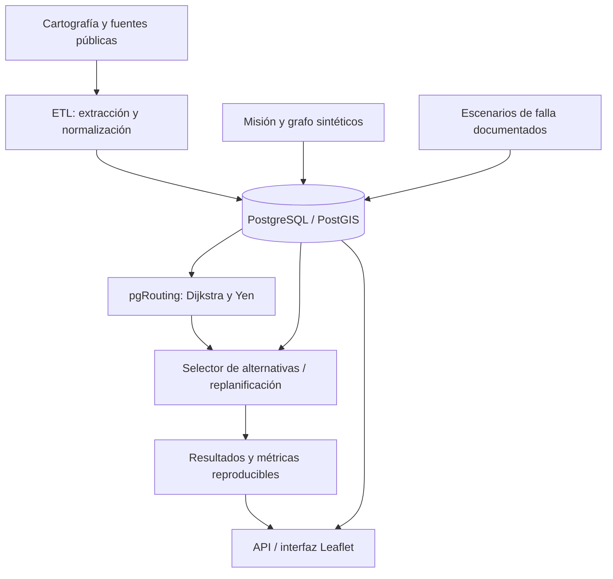

# Contexto del proyecto y propuesta de solución — Tarea 2

**Curso:** Algoritmos de Ruteo Resiliente  
**Proyecto:** AlgoritmosRuteo  
**Fecha de preparación:** 18 de octubre de 2026  
**Destinatarios:** integrantes del grupo  
**Estado del documento:** propuesta de trabajo para alinear al grupo; los aspectos marcados como *por definir* requieren acuerdo grupal o aclaración docente.

> **Resumen en una frase:** proponemos evaluar un mecanismo de **ruteo físico resiliente para una misión simulada de inspección territorial con UAV**, utilizando un solo grafo geolocalizado, información ambiental y urbana, escenarios controlados de fallas, rutas alternativas y replanificación; compararemos sus resultados con rutas calculadas únicamente por distancia.

---

## 1. ¿Para qué sirve este documento?

Este documento explica **qué se quiere construir y cómo se conecta con lo conversado durante la tarea 1, la retroalimentación docente y el enunciado de la tarea 2**. Está pensado para que todos los integrantes manejen la misma problemática y puedan continuar en el repositorio compartido sin interpretar de manera distinta la misión, el grafo o los algoritmos.

**No es un informe de implementación ni una afirmación de que la plataforma ya existe.** Presenta la arquitectura deseada, los criterios académicos y las decisiones necesarias para desarrollarla.

### La idea central

- **Antes:** queríamos estudiar cómo recuperar *rutas de transmisión de datos* en una red mesh de UAV cuando el jamming perjudica sus enlaces.
- **Ahora:** proponemos estudiar cómo recuperar o reemplazar *trayectorias físicas* de una misión de inspección cuando ciertos segmentos de navegación dejan de estar disponibles.
- **Lo que permanece:** resiliencia ante fallas, uso de grafos georreferenciados, alternativas de ruta, metadata ambiental/territorial, escenarios de perturbación y evaluación cuantitativa.
- **Lo que cambia de forma importante:** el significado de los nodos y las aristas, el algoritmo principal y las métricas. **No se debe presentar la nueva solución como una implementación de CLUN-LSR.**

---

## 2. De dónde venimos: propuesta original y por qué debemos reformularla

### 2.1. Tarea 1: red mesh de comunicaciones entre UAV

La propuesta de la primera entrega se apoyaba en el artículo **“Cross-layer UAV network routing protocol for spectrum denial environments”**, que presenta **CLUN-LSR** para recuperar caminos de comunicación en una red de UAV sometida a denegación de espectro.

En ese modelo:

- Un **nodo** es un UAV (u otro participante de la red).
- Una **arista** es un enlace inalámbrico entre dos participantes.
- La **ruta** es la secuencia de retransmisores por la que viajan los datos.
- La **falla** consiste, entre otras posibilidades, en la degradación de un enlace por interferencia.
- Como los UAV se mueven, la topología de comunicaciones cambia con el tiempo.

Ejemplo conceptual de comunicaciones:

```text
Antes:    UAV A ── UAV B ── UAV C ── estación

Si falla B:
          UAV A ── UAV D ── UAV E ── estación
```

**Esos trazos no representan el desplazamiento físico de los drones:** representan por dónde circula un paquete de datos.

Durante la tarea 1 se trabajó con fuentes como OpenSky, OpenTopography, OSM/Overpass, OpenWeather, OpenCellID, GPSJam, ACLED y OpenAIP. Se prepararon programas de consulta, datos geoespaciales, documentación, experimentos iniciales y elementos de PostgreSQL/PostGIS. Ese trabajo constituye una base técnica reutilizable, pero la obtención de datos no equivale a haber implementado un algoritmo de ruteo resiliente.

### 2.2. Qué aprendimos de la retroalimentación

Las observaciones recibidas sobre la primera entrega apuntaban a problemas de fondo:

1. **Problemática insuficientemente respaldada:** no basta con decir que el jamming ocurre o que un algoritmo tarda “mucho” en reaccionar; hay que aportar cifras y referencias aplicables al fenómeno concreto.
2. **Hipótesis poco refutable:** la hipótesis debe predecir una diferencia medible que pueda no cumplirse.
3. **Grafo dinámico vs. estático:** si los nodos eran UAV móviles, los enlaces no debían tratarse como conexiones permanentes.
4. **Incoherencia en las fuentes:** los aviones comerciales de OpenSky no son sustitutos representativos de drones de inspección a baja altura; cruzarlos directamente con edificios y terreno podía ser conceptualmente incorrecto.
5. **Modelo espacial incompleto:** al hablar de navegación o propagación a distintas alturas, una simple tabla 2D no basta para justificar un modelo 3D realista.
6. **Aporte algorítmico insuficientemente definido:** el objetivo central del curso es diseñar, implementar y **evaluar un mecanismo de ruteo resiliente**, no limitarse a construir bases de datos o depurar APIs.
7. **Referencias y resultados:** las afirmaciones, cifras y comparaciones deben venir de literatura o de experimentos reproducibles, no de supuestos presentados como hechos.

Las decisiones para la nueva solución buscan responder precisamente a esos reparos.

### 2.3. Por qué no basta con conservar CLUN-LSR sin cambios

CLUN-LSR resuelve un problema de **ruteo de comunicaciones**; la tarea 2 solicita representar una infraestructura geográfica, obtener al menos dos rutas entre origen y destino con `pgr_dijkstra` usando kilómetros, aplicar un algoritmo publicado, calcular resiliencia y mostrar resultados con Leaflet. Aunque una ruta de enlaces inalámbricos puede dibujarse en un mapa, la discusión con el profesor y el grupo llevó a explorar una misión concreta de **observación de un área** y su replanificación física.

**Conclusión del cambio:** CLUN-LSR permanece como antecedente histórico y motivación para hablar de resiliencia y degradación de conectividad. La nueva propuesta tiene otro objeto de optimización: **trayectorias de navegación física simulada**. Para estas se necesitan algoritmos y experimentos coherentes con desplazamiento, no métricas de entrega de paquetes que el sistema no modelará.

---

## 3. Nuevo contexto: ¿qué problema queremos resolver?

### 3.1. Escenario de referencia

Se propone un **caso de estudio civil inspirado en la ciudad o región de Mykolaiv, Ucrania**, donde existen antecedentes documentados de afectación de infraestructura y programas de recuperación. La relevancia del escenario consiste en la necesidad de recopilar información territorial y reevaluar infraestructura para fines de recuperación y monitoreo.

**Aclaración importante:** el contexto es real e histórico, pero la misión, los puntos de inspección, la malla de navegación y las fallas de segmentos serían **simulaciones académicas**. La propuesta no identifica posiciones militares ni pretende producir rutas de vuelo reales. El espacio aéreo de Ucrania está sujeto a restricciones vinculadas al conflicto; el grafo no debe interpretarse como una autorización o plan de vuelo.

Mykolaiv es una **localidad de referencia provisional**, no una obligación: puede cambiarse si otro entorno urbano permite justificar mejor los datos y la misión. En cualquier caso, elegir una ciudad porque es relevante en noticias no garantiza que las APIs entreguen información suficiente para el modelo.

### 3.2. Problema concreto

Supongamos que una organización civil necesita **visitar periódicamente varios puntos de observación** para recopilar información sobre el estado de infraestructura y sectores urbanos.

Se define una misión con un punto de salida, un pequeño conjunto de puntos que deben inspeccionarse y un punto de llegada. Existen varios segmentos potenciales para desplazarse por una red de navegación abstracta. Si un segmento deja de estar disponible durante la misión —por una perturbación **simulada** y explícitamente documentada—, el sistema debe encontrar una alternativa para continuar con los puntos pendientes.

El problema es determinar si **seleccionar alternativas antes de salir y replanificar al encontrar una falla** permite completar más misiones que utilizar solamente los caminos de menor distancia.

### 3.3. Pregunta de investigación

> ¿Un mecanismo de selección de rutas alternativas y replanificación, apoyado en información geoespacial y escenarios de falla, permite completar un porcentaje mayor de misiones simuladas de inspección territorial que un enfoque basado únicamente en distancia, manteniendo acotado el recorrido adicional?

### 3.4. Qué significa “resiliencia” aquí

Resiliencia **no es simplemente mostrar dos líneas diferentes** en un mapa. Para el proyecto significa comprobar si, cuando cambia la disponibilidad de segmentos del grafo, el sistema puede continuar una misión y alcanzar su destino respetando restricciones acordadas.

No se pretende demostrar resiliencia de los enlaces RF, PDR, capacidad contra jamming real ni navegación aérea certificada. Si se incluye una pérdida de comunicación, se representará como **condición hipotética de la misión** y no como una medición de interferencia.

---

## 4. Cómo sería la misión simulada

### 4.1. Mínimo viable propuesto

Para conciliar la idea grupal de **inspeccionar una zona** con los recorridos entre origen y destino que exige la tarea 2, se propone:

```text
Área de estudio urbana simulada

Inicio A  →  Observación P1  →  Observación P2  →  Observación P3  →  Destino B
              tramo 1             tramo 2             tramo 3         tramo 4
```

- Pueden comenzar con **dos puntos de inspección** y ampliar a tres si la plataforma funciona de manera estable.
- El **orden de visita se fija de antemano** en el mínimo viable; no es un problema completo de optimización de visitas múltiples.
- Cada par consecutivo de puntos constituye un **subproblema origen–destino** en el mismo grafo.
- Entre cada par habrá rutas candidatas de distinta longitud o disponibilidad.
- Al aparecer una falla durante un tramo, se reevaluará cómo llegar al próximo punto desde el estado actual.
- La evaluación principal es **cuántas misiones terminan con todos los puntos visitados y el destino alcanzado** dentro de un presupuesto de recorrido.

**Esto no es “cobertura continua” de un polígono.** Es una misión de *inspección de puntos representativos de una zona*. Para afirmar cobertura completa habría que definir sensor, huella de observación, orientación, altura y porcentaje de superficie observada, lo que se deja fuera del mínimo viable salvo acuerdo del grupo y del docente.

### 4.2. Relación con varios UAV

La misión puede describirse dentro de una operación de monitoreo con UAV, pero **la tarea 2 no necesita comenzar con coordinación simultánea de varios drones**. El modelo mínimo puede usar un vehículo simulado y un grafo compartido. La asignación dinámica de misiones a una flota y los protocolos de comunicación mesh se consideran ampliaciones posibles, no prestaciones incluidas en el alcance base.

---

## 5. Arquitectura conceptual: un único grafo físico

### 5.1. Significado de nodos y aristas

Se utilizará un grafo de navegación:

\[
G_t=(V,E_t,W_t)
\]

- **Vértices `V`:** puntos geográficos de navegación, algunos marcados como inicio, inspección o destino. **No son UAV**.
- **Aristas `E_t`:** segmentos candidatos de desplazamiento entre puntos, con geometría, longitud, dirección y estado. **No son enlaces radio ni calles de OSM**.
- **Pesos `W_t`:** distancia física para la referencia; costos o restricciones adicionales definidos por el modelo para el método propuesto.
- **Tiempo `t`:** representa cambios de disponibilidad introducidos en escenarios; no hace falta simular la movilidad de todos los vértices, porque los puntos de navegación pueden ser fijos mientras cambia el estado de sus aristas.

### 5.2. De dónde sale la infraestructura

La red no existe como un conjunto público de “calles para drones”. Por tanto se construirá como **una malla sintética geolocalizada**, basada en un área de referencia y enriquecida con información pública de terreno y ciudad:

1. Delimitar un área de estudio (AOI, *Area of Interest*) que sirva como referencia cartográfica.
2. Obtener polígonos de edificación y relieve para caracterizarla.
3. Definir puntos sintéticos de navegación y puntos de inspección.
4. Conectar puntos cercanos en una red suficientemente conectada para admitir varias alternativas.
5. Calcular la distancia de cada arista en kilómetros con el sistema de coordenadas y método de medición apropiados.
6. Asociar atributos geoespaciales y reglas de restricción justificadas.
7. Registrar en PostGIS las geometrías y en pgRouting la estructura `source`/`target` necesaria para los cálculos.

**La conectividad de la malla es una hipótesis del simulador**, no evidencia de corredores aéreos reales. Por eso es fundamental explicar cómo se generó y no denominarla “red de vuelos existente”.

### 5.3. Modelo 2,5D, no navegación 3D certificada

Una primera representación tendría ubicación horizontal (latitud/longitud) y un atributo de elevación del terreno, complementado con una o más alturas **supuestas** para el escenario. Esto se suele describir como **2,5D**.

- Un DEM de resolución de decenas de metros ayuda a caracterizar terreno general, no cada obstáculo urbano.
- OSM puede incluir altura de edificios y número de pisos, pero esos atributos suelen faltar.
- Intersectar una línea horizontal con el polígono de un edificio **no demuestra colisión aérea** sin información vertical suficiente.
- Las restricciones geométricas deben declararse como reglas académicas simplificadas, con limitaciones, y no como garantías de seguridad de vuelo.

### 5.4. Qué ocurre cuando se produce una falla

En lugar de modificar la posición de todos los nodos, el simulador actualiza **qué segmentos están disponibles**. Si el tramo elegido queda indisponible, conserva el estado de avance de la misión, calcula otro recorrido hacia el siguiente punto pendiente y vuelve a evaluar las condiciones. Puede también ocurrir que **no exista alternativa**; el sistema debe registrar ese fracaso y no inventar una ruta.

---

## 6. Metadata: para qué necesitamos los datos externos

La metadata no se recopilará solo para llenar tablas. Cada fuente debe aportar **una variable con interpretación concreta** para describir el escenario, aplicar una restricción o fundamentar una preferencia. El grupo debe mostrar ejemplos en los que la regla tenga un efecto comprobable sobre las decisiones.

| Fuente candidata | Datos aportados | Función propuesta | Límite que debe explicarse |
|---|---|---|---|
| **OSM / Overpass** | Huellas de edificaciones, usos de suelo y etiquetas de altura cuando existan | Caracterizar entorno urbano, definir preferencias o exclusiones **sintéticas** de ciertos sectores | No suministra automáticamente rutas aéreas; la cobertura de alturas puede ser incompleta |
| **OpenTopography** | Modelo digital de elevación (DEM) | Atributos generales del terreno y del modelo 2,5D | Su resolución no identifica obstáculos urbanos pequeños |
| **OpenWeather o Open-Meteo histórico** | Viento, precipitación u otras variables con fecha y unidades | Condición meteorológica global o por escenario; no necesariamente distinta por arista | El clima de un solo punto o el reanálisis de kilómetros de resolución no describe cada cuadra |

**Selección temporal:** si el caso usa episodios históricos, una fuente **histórica** como Open-Meteo resulta más coherente que mezclar observaciones meteorológicas de hoy con eventos de años anteriores. No se propone presentar OpenWeather y Open-Meteo como dos metadata independientes simplemente por ser dos servicios parecidos; se escogerá el proveedor que mejor ajuste al periodo.

Ejemplo abstracto de causalidad bien declarada:

```text
Dato: viento modelado para una fecha determinada
     ↓
Regla del simulador: si supera un umbral supuesto, la misión entra en modo restringido
     ↓
Efecto: cambian las condiciones de admisibilidad o éxito del experimento
```

No se deben confundir reglas hipotéticas con límites aeronáuticos reales.

---

## 7. Eventos, amenazas y fallas: distinguir conceptos

Es importante separar **tres niveles**:

1. **Registro externo:** lo que informa realmente una API (evento, polígono, anomalía, condición meteorológica).
2. **Interpretación del proyecto:** qué se puede inferir razonablemente de ese registro y cuáles son sus incertidumbres.
3. **Falla simulada:** regla reproducible que altera la disponibilidad de ciertos segmentos durante un ensayo.

Una base de datos de eventos **no equivale a una medición de segmentos aéreos bloqueados**. El proyecto debe declarar esta separación en el informe y en la plataforma.

### Fuentes candidatas de eventos

| Fuente | Qué mide o registra | Uso razonable en el proyecto | Advertencia |
|---|---|---|---|
| **ACLED** | Eventos históricos de conflicto con fecha y precisión geográfica variable | Contextualizar acontecimientos pasados a escala territorial | Un evento cercano no demuestra que un tramo de navegación esté bloqueado; no usarlo para deducir rutas militares |
| **NASA FIRMS** | Anomalías térmicas satelitales | Estudiar escenarios históricos o capas ambientales **si existen registros pertinentes** | Un punto FIRMS no confirma que exista un incendio de extensión conocida ni una restricción aérea real |
| **Copernicus Emergency Management Service (EMS)** | Cartografía de emergencias por activación | Alternativa para eventos ambientales georreferenciados, si hay productos que coinciden con el área/fecha | No todas las ciudades o fechas tienen una activación disponible |
| **GPSJam** | Indicadores de anomalías de precisión GNSS reportadas por aeronaves | Antecedente exploratorio de contexto GNSS | **No mide jamming del enlace de datos UAV** ni garantiza cobertura en la zona |
| **OpenAIP** | Información de espacio aéreo y restricciones publicadas | Posible capa de restricciones de referencia, si hay geometrías y vigencia útiles | Una restricción no es una “falla” observada; requiere interpretar límites verticales y fechas |
| **UNOSAT** | Evaluaciones satelitales de daño en infraestructura | Justificar zonas o puntos civiles de inspección histórica | El daño histórico no significa que un corredor de vuelo esté bloqueado hoy |

### Cuáles serían las tres fuentes definitivas

La tarea 2 exige **`n` fuentes de metadata y `n` fuentes de fallas/eventos**, siendo `n` el número de integrantes. En la presentación del grupo se identifican tres integrantes; por tanto, debemos organizar el trabajo con **tres metadata y tres fuentes independientes de eventos o amenazas**.

**No hay tres fuentes de amenazas definitivas elegidas en este documento.** ACLED, NASA FIRMS y Copernicus EMS son **candidatas de investigación**; GPSJam y OpenAIP quedan como alternativas condicionadas a pertinencia y disponibilidad. La selección requiere coherencia espacial y temporal y una interpretación válida de cada dato. Debemos consultar al profesor si **eventos externos con efectos de arista sintéticos** satisfacen el requisito académico de “fuentes de fallas”.

### Pérdida de comunicaciones y jamming

Es válido explicar que el proyecto nació de estudiar degradación de enlaces y que una pérdida de reportes puede motivar la necesidad de revisar una misión. **No se debe afirmar que la pérdida de comunicación demuestra jamming, que un UAV ha caído o que un tramo es físicamente intransitable**. En el alcance mínimo, las interrupciones se modelan como **fallas abstractas del grafo de navegación**, no como ingeniería de contramedidas electrónicas.

---

## 8. Algoritmos: qué vamos a comparar

El **núcleo científico del trabajo** es diseñar una regla de elección y replanificación y comprobar si mejora resultados sobre una línea base, no demostrar que Python logra conectarse a las APIs.

### 8.1. Método obligatorio de referencia: Dijkstra por distancia

`pgr_dijkstra` encuentra un camino mínimo según el costo configurado. Para la referencia, el costo de cada arista debe ser **solo su longitud en kilómetros**, tal como exige el enunciado.

La tarea pide **al menos dos rutas distintas**. Dos llamadas idénticas de `pgr_dijkstra` retornan normalmente el mismo camino; la segunda ruta debe obtenerse mediante una **regla determinista y documentada de desviación o exclusión**, sin reemplazar kilómetros por un costo enriquecido en esta línea base.

### 8.2. Generador de candidatos: Yen

El algoritmo de **Yen** (*Finding the K Shortest Loopless Paths in a Network*, 1971) produce varios caminos simples candidatos entre dos puntos. En pgRouting se dispone de `pgr_KSP`, que implementa un procedimiento de k caminos mínimos.

**Muy importante:** Yen **no garantiza por sí solo resiliencia**, no necesariamente genera rutas disjuntas y no debe presentarse como el algoritmo completo que inventamos.

### 8.3. Propuesta del grupo: selección resiliente y replanificación

El aporte que proponemos evaluar es un **mecanismo propio y acotado** que:

1. Obtiene varios caminos candidatos para un tramo.
2. Escoge un **par de rutas** con criterios explícitos: costo de recorrido permitido y exposición/solapamiento frente a los escenarios modelados.
3. Registra una ruta principal y una alternativa, sin garantizar que ambas sobrevivan a todas las fallas.
4. Si aparece una falla que afecta el tramo en ejecución, **replanifica desde la posición simulada actual** hacia el siguiente punto pendiente.
5. Declara fracaso si la misión ya no puede completarse dentro de las restricciones y el presupuesto, y conserva esa observación como resultado.

El **método exacto de puntuación y selección** todavía debe formalizarse en el diseño de algoritmos. No corresponde inventar resultados, mejoras garantizadas ni afirmar que este mecanismo es una reproducción completa de un paper.

### 8.4. Papel de Luna et al. (2024)

El artículo **“A multi-UAV system for coverage path planning applications with in-flight re-planning capabilities”** es un antecedente para misiones de inspección, puntos pendientes y replanificación tras eventos inesperados.

Sirve para justificar **por qué una misión de observación puede necesitar replanificación**, pero nuestro mínimo viable no implementará íntegramente el sistema multi-UAV del paper. El grupo debe citar con precisión qué ideas toma como inspiración y qué partes son implementaciones propias.

### 8.5. Comparación que permita atribuir el efecto

| Variante | Qué representa | Qué permite comprobar |
|---|---|---|
| **A. Dijkstra por km** | Dos alternativas determinadas por distancia | Rendimiento de la referencia solicitada |
| **B. Yen por km** | Conjunto de candidatos sin selección resiliente adicional | Cuánto cambia el resultado por generar más rutas |
| **C. Yen + selección + replanificación** | Mecanismo propuesto | Si la elección y la actualización durante fallas mejoran el éxito de misión |

El análisis debe comparar configuraciones con **las mismas condiciones de prueba y presupuesto**. Si C no mejora, también es un resultado científicamente válido.

---

## 9. Hipótesis, objetivos y métricas

### 9.1. Hipótesis de trabajo, refutable

> En misiones simuladas de inspección de puntos obligatorios, con fallas espaciales reservadas para evaluación, un mecanismo que selecciona dos alternativas y replantea el recorrido ante indisponibilidad de segmentos logrará una mayor proporción de misiones completadas que la selección basada solamente en `pgr_dijkstra` por distancia, **sin exceder un límite adicional de recorrido definido antes de los experimentos**.

La hipótesis **será rechazada** si la mejora esperada no aparece bajo condiciones equivalentes o si la ventaja exige superar el presupuesto acordado. Los parámetros experimentales deben fijarse antes de observar resultados finales.

### 9.2. Objetivo general

**Diseñar, implementar y evaluar un mecanismo de selección de rutas alternativas y replanificación física para misiones simuladas de inspección territorial, comparándolo con rutas calculadas únicamente por distancia ante fallas geolocalizadas reproducibles.**

### 9.3. Objetivos específicos

1. Definir una misión de inspección con origen, puntos de observación obligatorios y destino sobre un único grafo físico georreferenciado.
2. Integrar metadata y registros externos pertinentes, distinguiendo observaciones reales de restricciones y fallas simuladas.
3. Implementar la línea base de Dijkstra y el mecanismo propuesto, generando al menos dos alternativas para los pares evaluados.
4. Evaluar resiliencia y eficiencia mediante escenarios reproducibles, distancias y presupuesto de misión.
5. Visualizar las rutas, los eventos, las preferencias y la comparación de resultados en la plataforma exigida.

### 9.4. Métricas centrales

**Métrica principal: tasa de misiones completadas**

\[
R_{misión} = \frac{\text{misiones con todos los puntos visitados y destino alcanzado}}{\text{misiones evaluadas}}
\]

Todas las misiones exitosas deben respetar el presupuesto máximo de recorrido elegido antes de la evaluación.

**Métrica secundaria: disponibilidad de un par de rutas**

\[
R_{par} = \frac{\text{escenarios en que al menos una ruta preseleccionada permanece válida}}{\text{escenarios evaluados}}
\]

**Diferencial:**

\[
\Delta R = R_{propuesto} - R_{Dijkstra}
\]

La diferencia porcentual debe distinguir **puntos porcentuales** de incremento relativo. También interesa medir distancia total, sobrelongitud, número de replanificaciones, porcentaje de puntos visitados en misiones incompletas y tiempo de cálculo.

**Nota:** disponibilidad de rutas preseleccionadas **no es equivalente** a recuperación durante una misión; por eso se conservan ambas métricas.

### 9.5. Cómo evitar una comparación sesgada

- Igual grafo base, origen y destino, puntos obligatorios, restricciones y presupuesto para todos los métodos.
- Las mismas fallas para todos los métodos dentro de cada ensayo.
- Semillas aleatorias y parámetros registrados para reproducir resultados.
- Separar los escenarios usados para decidir parámetros de los reservados para la evaluación.
- Incluir casos sin alternativas, sin datos y con falla total para no ocultar limitaciones.
- Reportar tanto resultados favorables como desfavorables.

---

## 10. Arquitectura de la plataforma que exige la Tarea 2

La solución se puede organizar de la siguiente forma:



### Función de cada tecnología

| Herramienta | Función |
|---|---|
| **Python** | Extracción, normalización, construcción sintética del grafo, escenarios y experimentos |
| **PostgreSQL** | Persistencia de datos, configuraciones y resultados |
| **PostGIS** | Geometrías, referencia espacial, relaciones e índices espaciales |
| **pgRouting** | Cálculo de caminos sobre la red almacenada en la base de datos |
| **Docker Compose** | Instalación y ejecución reproducible de los servicios |
| **Leaflet** | Mapa interactivo, origen/destino, capas, rutas, alternativas y métricas |
| **Script principal** | Orquestación de preparación, ETL, carga de BD y arranque según la rúbrica |

### Modelo lógico de base de datos propuesto

No se necesita una tabla enorme por cada subtipo de evento, pero sí separar entidades importantes:

| Entidad / tabla lógica | Propósito |
|---|---|
| `fuentes_datos` / `extracciones` | Proveedor, fecha, versión, licencias, errores y procedencia |
| `zonas_estudio` | Polígono académico de referencia y su versión |
| `nodos` | Puntos sintéticos del grafo, con posición y atributos |
| `aristas` | Conectividad física y distancia en kilómetros |
| `metadata_*` | Atributos geográficos y temporales de cada fuente seleccionada |
| `eventos_*` | Observaciones de fuentes de eventos, sin atribuir causalidad automática |
| `reglas_escenario` | Traducción documentada de información a supuestos/restricciones |
| `misiones` / `puntos_observacion` | Definición y secuencia de la misión |
| `escenarios_falla` / `aristas_escenario` | Estado temporal y reproducible de cada experimento |
| `rutas` / `resultados` | Rutas candidatas, seleccionadas, cambios y métricas |

Es un **modelo conceptual**, no una prescripción de nombres físicos. El esquema final debe permitir recrear la base desde cero y documentar las relaciones.

### Mínimo que debe mostrar Leaflet

El sitio debe permitir elegir un origen y un destino pertenecientes a la misión, modificar preferencias que tengan efecto real, calcular y comparar rutas de los dos enfoques y observar al menos dos alternativas para cada método. Conviene además visualizar puntos de inspección, capas de contexto con leyenda, escenarios de falla sintéticos y valores de resiliencia, incluyendo situaciones en que no existe una ruta válida.

---

## 11. Requisitos de la Tarea 2: resumen de los 60 puntos

| Bloque de evaluación | Puntaje | Qué debe demostrar el equipo |
|---|---:|---|
| Docker, PostgreSQL/PostGIS/pgRouting, BD, SQL y diagrama | **4** | Levantar servicios y reconstruir el esquema desde cero |
| Extracción y carga de `n` fuentes de metadata | **8** | ETL, JSON/GeoJSON, descripción de cada estructura y carga a BD |
| Extracción y carga de `n` fuentes de eventos/fallas | **8** | Fuentes independientes, ETL, estructuras y carga a BD |
| Modelo de fallas, pesos y restricciones por metadata | **10** | Reglas explícitas, valores por defecto y trazabilidad de efectos |
| Algoritmo elegido, paper y explicación | **10** | Fundamentar Yen y describir **el mecanismo de selección/replanificación** |
| Al menos dos rutas Dijkstra y dos del método elegido | **8** | Rutas diferenciables y comparables para origen–destino |
| Métrica, interfaz y diferencial de resiliencia | **12** | Resultados calculados, comparación y visualización en Leaflet |
| **Total** | **60** | **Algoritmo evaluado + plataforma reproducible** |

**Aclaración relevante:** en una parte del enunciado se indica que integrar metadata/amenazas al algoritmo correspondería a una etapa posterior, pero la **rúbrica de esta misma tarea** asigna puntaje a pesos, restricciones y comparación. Para organizar el trabajo se debe **tomar la rúbrica como alcance de referencia y preguntar al profesor por esa discrepancia**.

### Qué no es suficiente para aprobar el aporte científico

- Tener seis APIs que responden HTTP 200.
- Descargar muchas geometrías sin traducirlas en reglas justificadas.
- Pintar dos rutas distintas en un mapa sin evaluar fallas.
- Usar Yen y afirmar que automáticamente se obtuvo resiliencia.
- Definir una hipótesis que solo diga “será posible estudiar”.

---

## 12. Qué se conserva del repositorio existente y cómo seguir trabajando

Los integrantes **ya tienen acceso al repositorio `AlgoritmosRuteo`**. Deben continuar sobre su estructura y documentación en lugar de crear otro proyecto desde cero.

Materiales de referencia en el repositorio (confirmar la ruta exacta en su copia):

```text
AlgoritmosRuteo/
├── 01_PROYECTO_ACTUAL/       # Contexto vigente, tarea 2 y decisiones del grupo
├── 02_REUNION_PROFESOR/      # Antecedentes de la conversación docente
├── 03_TAREA_1/              # Informe y pruebas históricas
├── 04_VALIDACION_TAREA_1/   # Código de extracción, SQL, Compose y datos de referencia
├── CONTEXTO_INTEGRAL_CODEX_RUTEO_UAV_2026_V3.md
└── README.md
```

Entre los programas existentes que merecen reutilización o adaptación están:

- `common.py`: utilidades geográficas y configuraciones.
- `02_opentopography.py`: descarga de relieve.
- `04b_osm_buildings_fallback.py`: obtención de edificaciones; debe preservar etiquetas y geometrías multipoligonales.
- `03_openweather.py`: extracción meteorológica; para experimentos fechados se requiere información histórica coherente.
- `05_gpsjam.py`, `06_acled.py`, `07_openaip.py`: ejemplos de extracción de eventos y geometrías, sujetos a redefinir su papel.
- `sql/init_postgis.sql`, `import_geojson_to_postgis.py`: esquemas y procedimientos de carga geoespacial que se pueden ampliar.
- `docker-compose.yml`, `run_all.py`: punto de partida para servicios y orquestación reproducible, **no se deben asumir completos para tarea 2**.

**Reglas de convivencia en el repositorio:** preservar documentos originales de la tarea 1; separar claramente código de la nueva solución; no subir `.env`, `credentials.json`, tokens ni datos con licencia restrictiva; preferir PR y revisiones; documentar unidades, esquemas y fuentes; mantener reproducibilidad de los experimentos.

### Repositorio para la entrega

El remoto de trabajo que el grupo conoce está en **GitHub**, pero el enunciado menciona **GitLab UDP**. Es necesario que el grupo defina cómo colocar allí la versión que se evaluará, manteniendo sincronía sin sobrescribir innecesariamente el repositorio actual.

---

## 13. Cómo desarrollar la solución por etapas

Se propone avanzar en dependencias lógicas, no en función de qué componente sea más vistoso:

| Etapa | Qué resolver | Entregable concreto |
|---|---|---|
| **1. Definición del escenario** | Misión, puntos obligatorios, zona y periodo de referencia; aclaraciones docentes | Ficha del caso de estudio y alcance aprobado |
| **2. Fuentes de datos** | Elegir tres metadata y tres eventos pertinentes, accesibles e independientes | Catálogo con campos, fechas, licencias y utilidad por fuente |
| **3. Infraestructura** | Diseñar esquema, generar grafo 2,5D sintético y cargarlo | SQL, diagrama, grafo con alternativas y ETL |
| **4. Algoritmos** | Dijkstra por km, Yen y mecanismo propuesto | Dos rutas por método, reglas y explicación formal |
| **5. Experimentos** | Escenarios controlados, presupuesto, métricas y comparación | Resultados reproducibles y gráficos/tablas |
| **6. Plataforma y entrega** | API, Leaflet, arranque automatizado, documentación | Demo funcional y materiales de presentación |

**Criterio principal de éxito del trabajo:** poder contestar con evidencia “¿qué método permitió completar más misiones, con qué costo adicional y bajo qué supuestos?”, no solamente “¿funcionó la interfaz?”.

### Reparto sugerido para tres integrantes

El reparto definitivo debe acordarlo el grupo, pero una división equilibrada sería:

| Frente | Responsabilidades | Integración necesaria |
|---|---|---|
| **A. Datos y geoespacial** | Zona, metadata, fuentes de eventos, ETL y procedencia | Entregar capas documentadas a BD y al modelo de escenarios |
| **B. Grafo y algoritmos** | Infraestructura física sintética, Dijkstra, Yen, selector, replanificación, métricas | Acordar contratos de datos con A y API con C |
| **C. Plataforma e integración** | Docker, pgRouting, esquema final, API, Leaflet y automatización | Integrar métodos y mostrar comparaciones reproducibles |

**Todos** deben participar en el diseño de la hipótesis, las restricciones, la explicación del paper, los experimentos y la presentación. La integración no debe quedar para el último día.

---

## 14. Decisiones pendientes que el grupo debe cerrar

Estas preguntas son importantes porque cambian el significado de lo que se va a implementar:

1. **Alcance de inspección:** ¿el profesor acepta una misión con 2–3 puntos representativos, comparando los tramos A→B, como mínimo viable de “inspección territorial”? No equivale a cobertura continua.
2. **Localidad y período:** ¿Mykolaiv seguirá siendo referencia o se seleccionará otra área según disponibilidad de fuentes? El caso debe mantenerse académico, histórico y no operacional.
3. **Tres fuentes de fallas/eventos:** ¿qué proveedores independientes se seleccionarán y cómo se documentará el vínculo entre observaciones y restricciones sintéticas? ¿El profesor acepta este enfoque?
4. **Algoritmo principal:** ¿el trabajo del paper principal será Yen con una contribución de selección/replanificación, usando Luna como fundamento de misión? Debe quedar claramente atribuido.
5. **Presupuesto y reglas de falla:** ¿cuáles son los parámetros de simulación, tratamiento de datos faltantes y criterios de finalización, definidos antes de evaluar?
6. **Alcance vertical:** ¿se aprueba un modelo 2,5D con limitaciones explícitas, sin afirmar navegación urbana tridimensional certificada?
7. **Entrega:** ¿cómo se garantiza que la versión final esté en el proyecto GitLab UDP solicitado?

No es necesario responder todo en una reunión larga, pero sí dejarlo asentado en un documento de decisiones compartido.

---

## 15. Bibliografía y enlaces recomendados

### Papers fundamentales

1. **Zheng et al. — “Cross-layer UAV network routing protocol for spectrum denial environments” (2024).** Paper original de CLUN-LSR y antecedente histórico de la tarea 1. [Artículo en ScienceDirect](https://www.sciencedirect.com/science/article/pii/S1570870524003135) · [DOI](https://doi.org/10.1016/j.adhoc.2024.103702).
2. **Yen, J. Y. — “Finding the K Shortest Loopless Paths in a Network” (1971).** Base de rutas candidatas alternativas. [DOI](https://doi.org/10.1287/mnsc.17.11.712).
3. **Luna et al. — “A multi-UAV system for coverage path planning applications with in-flight re-planning capabilities” (2024).** Antecedente de inspección y replanificación; no implica reproducción íntegra de ese sistema. [DOI](https://doi.org/10.1002/rob.22342).
4. **Suurballe, J. W. — “Disjoint paths in a network” (1974).** Referente opcional si el grupo justifica explícitamente rutas sin segmentos comunes; no forma parte obligatoria del mínimo viable. [DOI](https://doi.org/10.1002/net.3230040204).

### Plataformas y fuentes técnicas

- [pgRouting — documentación oficial](https://docs.pgrouting.org/latest/en/) (`pgr_dijkstra`, `pgr_KSP` y funciones relacionadas).
- [PostGIS — documentación](https://postgis.net/documentation/).
- [Leaflet — documentación](https://leafletjs.com/reference.html).
- [OpenStreetMap / Overpass API](https://wiki.openstreetmap.org/wiki/Overpass_API).
- [OSM: etiquetas de altura](https://wiki.openstreetmap.org/wiki/Key:height).
- [OpenTopography — API](https://www.opentopography.org/developers).
- [Open-Meteo — datos meteorológicos históricos](https://open-meteo.com/en/docs/historical-weather-api).
- [OpenWeather API](https://openweathermap.org/api).
- [ACLED — documentación API](https://acleddata.com/api-documentation/acled-endpoint) y [codebook](https://acleddata.com/methodology/acled-codebook).
- [NASA FIRMS — API geográfica](https://firms.modaps.eosdis.nasa.gov/api/area/).
- [Copernicus Emergency Management Service](https://mapping.emergency.copernicus.eu/).
- [GPSJam — preguntas frecuentes](https://gpsjam.org/faq).
- [OpenAIP](https://www.openaip.net/).
- [UNOSAT — evaluación histórica de Mykolaiv](https://unosat.org/products/3404).

### Contexto civil documental

- [PNUD / UNDP — Mykolaiv Strategic Partnership](https://www.undp.org/ukraine/projects/mykolaiv-strategic-partnership).
- [PNUD / UNDP — equipamiento para cinco comunidades ucranianas y recopilación de datos para la recuperación](https://www.undp.org/ukraine/press-releases/undp-provides-equipment-five-ukrainian-communities-support-data-driven-recovery).
- [PNUD / UNDP — tecnología aérea para desminado humanitario](https://www.undp.org/ukraine/press-releases/undp-equips-sesu-cutting-edge-ukrainian-aerial-detection-technology-accelerate-humanitarian-demining-operations) (antecedente de empleo civil de tecnología aérea, **no** define nuestra misión ni valida rutas).

### Documentos internos que debe consultar cada integrante

Buscar en `AlgoritmosRuteo` el **enunciado y rúbrica original de la tarea 2**, el **informe final y las referencias de la tarea 1**, los documentos de la **conversación con el profesor**, y la documentación de código y fuentes. Este resumen ayuda a iniciar el trabajo, pero **el enunciado docente y las decisiones del grupo prevalecen cuando exista una discrepancia**.

---

## 16. Mensaje final al grupo: qué acordamos y qué se espera conseguir

**La solución nueva no es “conseguir que varios UAV mantengan una red mesh frente a jamming”.** Ese era el problema original y sigue siendo un antecedente válido, pero tiene otro grafo, otra unidad de ruteo y otras métricas.

**La solución nueva es evaluar si una misión simulada de inspección territorial puede continuar tras fallas de segmentos gracias a rutas alternativas y replanificación.** Para ello:

1. Se define una zona de referencia y una misión pequeña con puntos de inspección.
2. Se construye **un grafo físico sintético geolocalizado** y se lo enriquece con metadata útil.
3. Se describen eventos externos por separado de **escenarios de fallas simuladas**, sin atribuir causalidades injustificadas.
4. Se comparan **Dijkstra por kilómetros** y **Yen más un mecanismo explícito de selección y replanificación**.
5. Se mide de manera reproducible la **tasa de misiones completadas** y el costo adicional de recorrer alternativas.
6. Se implementa y demuestra la plataforma exigida con **Docker, PostgreSQL, PostGIS, pgRouting, ETL y Leaflet**.

**El aporte que debe defender el grupo ante el profesor es el mecanismo de ruteo y su evaluación**, no la cantidad de APIs, la complejidad de la base de datos ni lo atractivo del mapa. La propuesta debe ser específica, refutable, verificable y honesta sobre la diferencia entre datos públicos observados y simulación.

---

*Documento preparado para alinear a los integrantes del grupo antes de continuar el desarrollo. Las elecciones descritas como “propuestas” no deben presentarse como decisiones finales ni como resultados empíricos hasta que el equipo las acuerde y las compruebe.*
